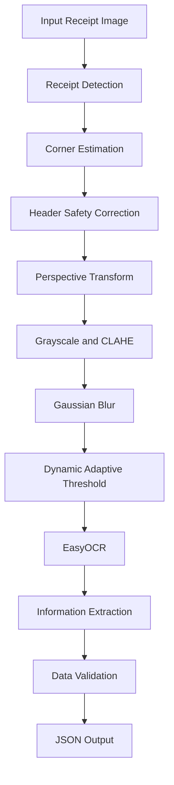

# 영수증톡톡 (ReceiptVision-KW)

광운대학교 심화전공실습 팀 프로젝트

## 1. Project Overview

영수증톡톡은 촬영된 영수증 이미지에서 영수증 영역을 자동으로 검출하고, 이미지 전처리와 OCR을 통해 주요 정보를 구조화된 JSON 데이터로 변환하는 프로젝트입니다.

촬영 환경에 따른 원근 왜곡, 조명 변화, 배경 노이즈 및 이미지 해상도 차이로 발생하는 OCR 인식 문제를 개선하는 것을 목표로 합니다.

### 주요 기능

- 영수증 영역 자동 검출
- Contour 및 Hough Line 기반 후보 영역 생성
- 영수증 모서리 검출 및 후보 영역 평가
- Perspective Transform을 통한 원근 왜곡 보정
- 영수증 상단 정보 손실 방지
- Dynamic Adaptive Threshold 기반 이미지 전처리
- EasyOCR 기반 한글 및 영문 문자 인식
- 상호명, 날짜, 상품명, 수량 및 금액 추출
- 상품 합계와 총금액의 일치 여부 검증
- 구조화된 JSON 결과 저장

## 2. System Architecture





전체 처리 과정은 `receipt_pipeline.py`를 통해 실행됩니다.

| Module | Description |
|---|---|
| preprocessing.py | 영수증 검출, 원근 보정 및 OCR용 이미지 생성 |
| ocr.py | EasyOCR 기반 문자 인식 |
| information_extractor.py | OCR 결과 분석 및 영수증 정보 추출 |
| receipt_pipeline.py | 전처리, OCR, 정보 추출 통합 실행 |

## 3. Preprocessing Algorithm

### 3.1 Receipt Detection

Contour 및 Hough Line을 기반으로 영수증 영역의 후보를 생성합니다.

후보 영역의 기하학적 특성과 경계 정보를 평가하여 최종 영수증 영역을 선택합니다.

### 3.2 Perspective Transform

검출된 영수증의 네 모서리 좌표를 이용하여 원근 왜곡을 보정합니다.

촬영 각도에 의해 기울어지거나 왜곡된 영수증을 정면 형태의 이미지로 변환하여 OCR에 적합한 입력을 생성합니다.

### 3.3 Header Safety Correction

영수증 상단의 상호명 및 주요 정보가 원근 보정 과정에서 잘리는 문제를 완화하기 위해 OCR용 모서리 좌표를 보정합니다.

영수증 검출 좌표와 OCR용 보정 좌표를 구분하여 관리합니다.

### 3.4 Dynamic Adaptive Threshold (V5.2)

기존 방식은 이미지 해상도와 관계없이 Adaptive Threshold의 Block Size를 21로 고정했습니다.

고해상도 영수증에서는 고정된 Block Size가 문자 내부의 손실이나 불필요한 노이즈를 발생시킬 수 있습니다.

이를 개선하기 위해 원근 보정된 영수증 이미지의 너비에 따라 Block Size를 동적으로 결정합니다.

```python
def get_dynamic_block_size(width):
    block = max(21, min(81, int(21 * width / 800)))

    if block % 2 == 0:
        block += 1

    return block
```

전처리 과정은 다음과 같습니다.

1. Grayscale 변환
2. CLAHE를 이용한 국소 대비 개선
3. Gaussian Blur를 이용한 노이즈 완화
4. 이미지 너비 기반 Block Size 계산
5. Adaptive Gaussian Threshold 적용

| Parameter | Value |
|---|---|
| CLAHE Clip Limit | 2.0 |
| CLAHE Tile Grid Size | (8, 8) |
| Gaussian Kernel Size | (3, 3) |
| Adaptive Threshold | Gaussian |
| Block Size | 21 ~ 81 (홀수) |
| Threshold Constant C | 10 |

기본 전처리 모드는 `dynamic`이며, 기존 고정 Block Size 방식도 선택할 수 있습니다.

## 4. Project Structure

```text
RecieptVision-KW/
├── preprocessing.py
├── ocr.py
├── information_extractor.py
├── receipt_pipeline.py
│
├── receiptvision_example.py
├── batch_test.py
├── run_items_ocr.py
├── merge_receipt_ocr.py
│
├── test_information_extractor.py
├── test_ocr_variant_consensus.py
├── test_receipt_regression.py
├── test_pipeline_v5.py
├── test_processing.py
├── test_top_safety_v5_1.py
│
├── examples/
│   └── clear_korean_receipt.json
│
├── tests/
│   └── fixtures/
│       ├── clear_korean_receipt_final.json
│       └── items_ocr_comparison.json
│
├── requirements.txt
├── README.md
└── .gitignore
```

### 주요 파일 설명

| File | Description |
|---|---|
| preprocessing.py | 영수증 이미지 전처리 모듈 |
| ocr.py | OCR 실행 및 인식 결과 반환 |
| information_extractor.py | 영수증 주요 정보 추출 및 검증 |
| receipt_pipeline.py | 전체 파이프라인 실행 |
| receiptvision_example.py | 전처리 모듈 사용 예제 |
| batch_test.py | V5.2 기반 일괄 전처리 및 CSV 결과 저장 |
| run_items_ocr.py | 상품 영역 OCR 실험용 스크립트 |
| merge_receipt_ocr.py | 복수 OCR 결과 병합용 스크립트 |
| tests/fixtures/ | 회귀 테스트용 JSON 데이터 |
| requirements.txt | 프로젝트 필수 라이브러리 |

일부 실험용 및 이전 버전의 보조 스크립트는 별도의 이미지나 출력 데이터가 필요하며, 최신 통합 파이프라인과 호환되지 않을 수 있습니다.

## 5. Installation

### 5.1 Tested Environment

| Environment | Version |
|---|---|
| OS | Windows 10 |
| Python | 3.13.14 |
| EasyOCR | 1.7.2 |
| OpenCV Headless | 5.1.0.95 |
| NumPy | 2.5.4 |
| PyTorch | 2.15.0+cpu |
| Torchvision | 0.29.2+cpu |
| Execution Device | CPU |

### 5.2 Clone Repository

```bash
git clone https://github.com/Junyechan/RecieptVision-KW.git
cd RecieptVision-KW
```

### 5.3 Create Virtual Environment

Windows CMD 기준:

```cmd
python -m venv .venv
.venv\Scripts\activate.bat
```

### 5.4 Install Dependencies

```bash
python -m pip install --upgrade pip
python -m pip install -r requirements.txt
```

필수 라이브러리는 다음과 같습니다.

```text
easyocr==1.7.2
opencv-python-headless==5.1.0.95
numpy==2.5.4
```

PyTorch 및 Torchvision 등 EasyOCR의 간접 의존성은 설치 과정에서 함께 설치됩니다.

OpenCV 패키지 간 충돌을 방지하기 위해 `opencv-python-headless`만 사용합니다.

설치 후 의존성을 확인할 수 있습니다.

```bash
python -m pip check
```

EasyOCR 모델이 설치되어 있지 않은 환경에서는 최초 실행 시 모델 다운로드를 위한 인터넷 연결이 필요할 수 있습니다.

## 6. Usage

### 6.1 Prepare Receipt Image

프로젝트 폴더에 `images` 디렉터리를 생성하고 테스트할 영수증 이미지를 저장합니다.

```text
RecieptVision-KW/
└── images/
    └── receipt_01.jpg
```

개인정보 보호 및 저장소 용량 관리를 위해 원본 실험 이미지는 기본적으로 Git 저장소에 포함하지 않습니다.

### 6.2 Run Full Pipeline

```bash
python receipt_pipeline.py images/receipt_01.jpg
```

기본적으로 Dynamic Adaptive Threshold가 적용되며 결과는 다음 경로에 저장됩니다.

```text
outputs/receipt_result.json
```

### 6.3 Specify Output Path

```bash
python receipt_pipeline.py images/receipt_01.jpg --output outputs/result.json
```

### 6.4 Select Preprocessing Method

```bash
python receipt_pipeline.py images/receipt_01.jpg --method dynamic
```

기존 B21 방식으로 실행하려면 다음 명령어를 사용합니다.

```bash
python receipt_pipeline.py images/receipt_01.jpg --method clahe_gaussian_b21_c10
```

| Method | Description |
|---|---|
| dynamic | 이미지 너비 기반 동적 Block Size |
| grayscale | Grayscale 이미지 |
| baseline_adaptive | 기본 Adaptive Threshold |
| clahe_gaussian_b21_c10 | 고정 Block Size 21 |
| clahe_gaussian_b31_c10 | 고정 Block Size 31 |
| clahe_gaussian_b41_c10 | 고정 Block Size 41 |

### 6.5 Python API

```python
from receipt_pipeline import process_receipt

result = process_receipt(
    "images/receipt_01.jpg",
    output_json="outputs/result.json"
)

if result["success"]:
    print(result["receipt"])
else:
    print(result["error"])
```

### 6.6 Preprocessing Only

OCR 없이 전처리 모듈만 사용할 수도 있습니다.

```python
from preprocessing import preprocess_receipt, save_image

result = preprocess_receipt(
    "images/receipt_01.jpg",
    method="dynamic"
)

if result["success"]:
    save_image("warped.png", result["warped"])
    save_image("ocr_ready.png", result["ocr_image"])

    print("Method:", result["method"])
    print("Actual Method:", result["actual_method"])
    print("Block Size:", result["block_size"])
else:
    print(result["error"])
```

### 6.7 Batch Preprocessing

여러 영수증 이미지에 대해 전처리를 일괄 실행할 수 있습니다.

```bash
python batch_test.py --images images
```

출력 경로와 전처리 방식을 지정할 수도 있습니다.

```bash
python batch_test.py --images images --output outputs/batch_test --method dynamic
```

이미지별로 다음 결과가 저장됩니다.

- warped.png: 원근 보정 이미지
- ocr_ready.png: OCR 입력용 전처리 이미지
- detection_overlay.png: 영수증 검출 결과 시각화
- test_results.csv: 전체 이미지 처리 결과 및 검출 정보

### 6.8 Preprocessing Example

단일 영수증 이미지에 대한 전처리 예제를 실행할 수 있습니다.

```bash
python receiptvision_example.py images/receipt_01.jpg
```

기본적으로 Dynamic Adaptive Threshold가 적용되며, 결과는 `outputs/ocr_handoff/`에 저장됩니다.


## 7. Output Format

전체 파이프라인의 결과는 다음 세 가지 주요 데이터로 구성됩니다.

| Field | Description |
|---|---|
| preprocessing | 전처리 방식 및 영수증 검출 정보 |
| ocr | OCR 원문, 인식 좌표 및 신뢰도 |
| receipt | 구조화된 영수증 정보 |

### JSON Example

아래는 반환 구조를 설명하기 위한 간략화된 예시입니다.

```json
{
  "success": true,
  "preprocessing": {
    "method": "dynamic",
    "actual_method": "clahe_gaussian_b41_c10",
    "block_size": 41
  },
  "receipt": {
    "merchant": "EXAMPLE STORE",
    "date": "2026-10-30",
    "items": [
      {
        "name": "PRODUCT A",
        "quantity": 1,
        "unit_price": 10000,
        "price": 10000,
        "currency": "KRW"
      }
    ],
    "total": 10000,
    "currency": "KRW",
    "validation": {
      "item_count": 1,
      "item_sum": 10000,
      "total_matches_item_sum": true
    }
  }
}
```

실제 출력에는 OCR 원문, 검출 점수, 검출 방식 및 추가 검증 정보가 포함됩니다.

## 8. Experimental Results

### 8.1 Receipt Detection Performance

수동으로 지정한 영수증 모서리 좌표를 기준으로 V5 영수증 검출 성능을 평가했습니다.

| Metric | Result |
|---|---:|
| Test Images | 6 |
| Mean IoU | 0.9575 |
| Mean Corner Error | 약 8.31 px |
| IoU >= 0.90 | 6 / 6 |

IoU는 예측한 영수증 영역과 실제 영수증 영역의 중첩 정도를 나타냅니다.

해당 결과는 제한된 실험 이미지에 대한 평가이며, 모든 촬영 환경에서 동일한 검출 성능을 보장하지 않습니다.

### 8.2 Dynamic Adaptive Threshold Performance

고해상도 영수증 이미지에 대해 기존 B21 방식과 V5.2 Dynamic 방식을 비교했습니다.

| Metric | Baseline B21 | Dynamic V5.2 |
|---|---:|---:|
| Block Size | 21 | 41 |
| Target Token Match | 4 / 9 | 8 / 9 |
| Target Token Match Rate | 44.44% | 88.89% |
| Mean OCR Confidence | 0.5660 | 0.5949 |

Dynamic 방식 적용 후 대상 문자열 일치율이 약 44.44%p 개선되었습니다.

기존 테스트 이미지 6개에서는 B21이 선택되어 기존 전처리 결과와 픽셀 단위로 동일한 OCR 입력 이미지가 생성되는 것을 확인했습니다.

Target Token Match는 사전에 정의한 문자열의 OCR 결과 내 포함 여부를 평가한 지표이며, 전체 문자 인식 정확도나 구조화된 정보 추출 정확도를 의미하지 않습니다.

### 8.3 Clean Environment Integration Test

기존 개발 환경과 분리된 신규 Python 가상환경을 생성하고 `requirements.txt`를 기반으로 라이브러리를 설치하여 전체 파이프라인을 검증했습니다.

| Image | Block Size | Processing Time | Result |
|---|---:|---:|---|
| receipt_01.jpg | 21 | 7.70 s | PASS |
| receipt_02.jpg | 21 | 2.37 s | PASS |
| receipt_03.jpg | 21 | 6.11 s | PASS |
| receipt_04.jpg | 21 | 4.00 s | PASS |
| receipt_05.jpg | 21 | 2.19 s | PASS |
| receipt_06.png | 41 | 10.32 s | PASS |
| sample_receipt.jpg | 21 | 4.37 s | PASS |
| Total | - | 37.06 s | 7 / 7 PASS |

평균 처리 시간은 약 5.29초입니다.

처리 시간은 CPU 환경에서 모델 초기화와 JSON 저장을 포함한 단일 실행 측정값입니다.

PASS는 전체 파이프라인이 오류 없이 실행되었음을 의미하며, 모든 영수증 정보가 정확하게 추출되었음을 의미하지 않습니다.

### 8.4 Information Extraction Results

전체 테스트 이미지 7개에 대한 정보 반환 및 내부 검증 결과입니다.

| Metric | Result |
|---|---:|
| Pipeline Execution Success | 7 / 7 |
| Merchant Field Returned | 1 / 7 |
| Date Field Returned | 6 / 7 |
| Total Matches Item Sum | 4 / 7 |
| Total Mismatch | 3 / 7 |

정보 반환 여부 및 내부 금액 일치 여부는 실제 정답 데이터와의 정확도 평가와 구분됩니다.

## 9. Testing

### 9.1 Unit and Regression Tests

다음 명령어를 통해 정보 추출 및 OCR 결과 병합 관련 테스트를 실행할 수 있습니다.

```bash
python -m unittest test_information_extractor test_receipt_regression test_ocr_variant_consensus -v
```

### Test Results

| Test Module | Passed |
|---|---:|
| test_information_extractor | 7 / 7 |
| test_receipt_regression | 7 / 7 |
| test_ocr_variant_consensus | 5 / 5 |
| Total | 19 / 19 |

신규 가상환경에서도 동일하게 19개 테스트가 모두 통과했습니다.

### 9.2 Dependency Validation

```bash
python -m pip check
```

신규 가상환경에서 의존성 충돌이 발견되지 않았으며, OpenCV 패키지 중복 설치 없이 전체 파이프라인이 실행되는 것을 확인했습니다.


### 9.3 Batch Preprocessing Test

최신 V5.2 전처리 API를 기반으로 일괄 처리 기능을 검증했습니다.

| Metric | Result |
|---|---:|
| Test Images | 7 |
| Receipt Detection Returned | 7 / 7 |
| Valid OCR Input Images | 7 / 7 |
| Successful Processing | 7 / 7 |
| Processing Errors | 0 |
| Processing Success Rate | 100% |

모든 테스트 이미지에서 유효한 OCR 입력 이미지가 생성되었으며, 전처리 결과 및 CSV 파일이 정상적으로 저장되었습니다.

처리 성공률은 영수증 검출 및 전처리 과정의 실행 성공 여부를 나타내며, 검출 정확도나 OCR 인식 정확도와는 구분됩니다.


## 10. Known Issues

현재 프로젝트는 영수증 이미지 기반 OCR 및 정보 추출 프로토타입이며 다음과 같은 한계가 존재합니다.

- 저해상도 이미지에서 한글 상호명 및 상품명 인식률이 낮을 수 있습니다.
- 영수증의 심한 구김, 곡면 왜곡 및 그림자는 OCR 성능에 영향을 줄 수 있습니다.
- 승인번호, 매장 정보 등의 숫자가 상품 금액으로 잘못 추출될 수 있습니다.
- 일부 영수증에서 상품 합계와 실제 총금액이 일치하지 않을 수 있습니다.
- 상호명 또는 날짜가 추출되지 않을 경우 null이 반환될 수 있습니다.
- 현재 정보 추출 로직은 한국어 영수증 및 KRW 중심으로 구성되어 있습니다.
- 복수 OCR 결과 병합 기능은 기본 통합 파이프라인에 자동 적용되지 않습니다.
- 일부 이전 버전의 실험 스크립트는 최신 전처리 API와 호환되지 않을 수 있습니다.
- 다른 운영체제 및 EasyOCR 모델의 최초 다운로드 환경은 별도로 검증하지 않았습니다.
- 간접 의존성의 모든 버전을 고정하지 않았으므로 향후 라이브러리 업데이트에 따라 실행 환경이 달라질 수 있습니다.

향후 다양한 영수증 데이터 확보, 상품 영역 분리 개선, OCR 후처리 및 정보 추출 규칙 고도화를 통해 이러한 문제를 개선할 수 있습니다.

## 11. Team & Contributions

광운대학교 심화전공실습 팀 프로젝트

| Member | Role | Contributions |
|---|---|---|
| 전예찬 (Junyechan) | Team Leader / Image Preprocessing | 영수증 검출, 모서리 추정, 원근 보정, 이미지 전처리, V5.2 Dynamic Adaptive Threshold, 전체 파이프라인 통합 및 검증 |
| 제이란 바리시잔 (sanzican) | OCR / Information Extraction | EasyOCR 연동, OCR 결과 분석, 영수증 정보 추출, 금액 검증, 복수 OCR 결과 병합 및 회귀 테스트 |

## 12. Technologies

- Python
- OpenCV
- NumPy
- EasyOCR
- PyTorch
- Git
- GitHub

## 13. References

- OpenCV: https://opencv.org/
- OpenCV Documentation: https://docs.opencv.org/
- EasyOCR: https://github.com/JaidedAI/EasyOCR
- NumPy: https://numpy.org/
- PyTorch: https://pytorch.org/
